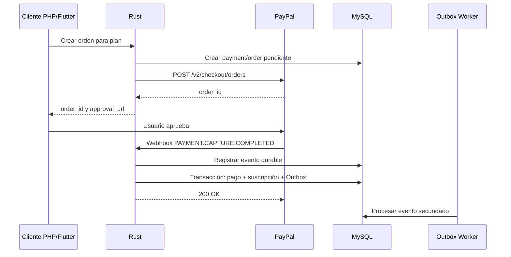

# OPALINE_PHASE2_3_0_PAYMENT_ARCHITECTURE.md

## Diseño arquitectónico de integración de pagos reales para Opaline AI

Fecha: 2026-11-08  
Modo: análisis y diseño únicamente. No se modificó código, migraciones, bases de datos, dependencias ni configuraciones.

---

## 1. Resumen ejecutivo

Opaline AI ya dispone de un núcleo comercial con planes versionados, suscripciones, cuotas, reservas de consumo, metering, idempotencia y Outbox. La integración de pagos reales debe añadirse sin romper esa arquitectura.

La recomendación principal es utilizar **PayPal Orders API v2 para cobros puntuales**, manteniendo la renovación manual en el MVP. No se recomienda PayPal Subscriptions en la primera implementación porque añade complejidad de webhooks, estados y sincronización que no es necesaria mientras Opaline valida su modelo comercial.

Rust será el único componente autorizado para cambiar estados financieros. MySQL será la fuente de verdad. PHP y Flutter únicamente iniciarán o consultarán operaciones. Los eventos secundarios se publicarán mediante el Outbox existente.

---

## 2. Estado real del código existente

### 2.1 Implementado

- `plans` y `plan_versions`.
- `subscriptions` con periodos, estados, `plan_version_id` e `is_current`.
- `payments` con estados `pending`, `completed`, `failed`, `refunded`.
- `invoices` con folio.
- `activate_subscription()` en `plans.rs`.
- Outbox transaccional y workers controlados.
- Endpoints de planes, suscripciones, consumo y administración.

### 2.2 Parcial o simulado

- `POST /api/v1/payments/paypal/create` crea una orden local pendiente y una suscripción pendiente.
- `GET /api/v1/payments/paypal/verify/:order_id` responde `501 Not Implemented`.
- `POST /api/v1/facturas/:id/reembolso` responde `501 Not Implemented`.
- La URL de aprobación es local y no corresponde a PayPal.
- `payment_provider_configured()` devuelve `false`.
- Las facturas son texto plano, no documentos fiscales oficiales.

### 2.3 Fuera de alcance de esta fase

No se implementa PayPal, webhooks, reembolsos, facturación fiscal ni renovación automática.

---

## 3. Skills consultadas y evidencia

| Skill | Consultada | Aplicada | Evidencia |
|---|---|---|---|
| `opaline-skills-router` | Sí | Sí | Selección y priorización de skills |
| Auditoría estática previa | Sí | Sí | Identificación de brechas |
| Auditoría de seguridad previa | Sí | Sí | Controles de autenticación y aislamiento |

Las recomendaciones de seguridad e idempotencia de las auditorías previas se reutilizan para el diseño financiero.

---

## 4. Arquitectura propuesta

### 4.1 Principios

- Rust es la autoridad financiera.
- MySQL es la fuente de verdad.
- PHP y Flutter no deciden estados de pago.
- PayPal es un proveedor externo, no la autoridad del sistema.
- Todos los cambios financieros deben ser idempotentes.
- Los efectos secundarios se publican mediante Outbox.
- Sandbox y Live deben estar completamente separados.

### 4.2 Flujo principal



### 4.3 Flujo de respuesta perdida

Si el cliente no recibe la respuesta de creación de orden:

1. El cliente puede consultar el estado de la orden.
2. Rust localiza la orden por `order_id` o por clave de idempotencia.
3. No se crea una segunda orden.
4. Si la orden ya fue aprobada y capturada, se devuelve el estado real.

---

## 5. Modelo de datos propuesto

### 5.1 Tablas existentes que se reutilizan

| Tabla | Uso |
|---|---|
| `users` | Propietario del pago |
| `plans` | Plan comercial |
| `plan_versions` | Condiciones contratadas |
| `subscriptions` | Suscripción activada por pago |
| `payments` | Pago local |
| `invoices` | Comprobante interno |
| `outbox_events` | Eventos secundarios |

### 5.2 Tablas propuestas

#### `payment_orders`

Propósito: representar la intención de compra antes de la captura.

| Campo | Tipo | Descripción |
|---|---|---|
| `id` | VARCHAR(36) | ID interno |
| `user_id` | VARCHAR(36) | Propietario |
| `plan_id` | VARCHAR(36) | Plan |
| `plan_version_id` | VARCHAR(36) | Versión contratada |
| `provider` | VARCHAR(32) | `paypal` |
| `provider_order_id` | VARCHAR(120) | ID de PayPal, único |
| `amount` | DECIMAL(10,2) | Importe |
| `currency` | VARCHAR(8) | Moneda |
| `status` | ENUM | `created`, `approved`, `captured`, `failed`, `cancelled`, `expired` |
| `idempotency_key` | VARCHAR(128) | Clave del cliente |
| `created_at` | DATETIME | Creación |
| `updated_at` | DATETIME | Actualización |
| `expires_at` | DATETIME | Expiración de la orden |

Restricciones:

- `UNIQUE (provider, provider_order_id)`
- `UNIQUE (user_id, idempotency_key)`

#### `payment_transactions`

Propósito: registrar capturas o transacciones del proveedor.

| Campo | Tipo | Descripción |
|---|---|---|
| `id` | VARCHAR(36) | ID interno |
| `payment_order_id` | VARCHAR(36) | Orden asociada |
| `provider_transaction_id` | VARCHAR(120) | ID de captura de PayPal |
| `amount` | DECIMAL(10,2) | Importe capturado |
| `currency` | VARCHAR(8) | Moneda |
| `status` | ENUM | `pending`, `completed`, `declined`, `refunded`, `partially_refunded` |
| `created_at` | DATETIME | Creación |

Restricción:

- `UNIQUE (provider_transaction_id)`

#### `payment_webhook_events`

Propósito: registrar eventos de PayPal de forma durable.

| Campo | Tipo | Descripción |
|---|---|---|
| `id` | VARCHAR(36) | ID interno |
| `provider` | VARCHAR(32) | `paypal` |
| `provider_event_id` | VARCHAR(120) | ID del evento de PayPal |
| `event_type` | VARCHAR(120) | Tipo de evento |
| `payment_order_id` | VARCHAR(36) | Orden asociada, nullable |
| `payload` | JSON | Evento original |
| `status` | ENUM | `received`, `processed`, `ignored`, `failed` |
| `received_at` | DATETIME | Recepción |
| `processed_at` | DATETIME | Procesamiento |
| `last_error` | TEXT | Error |

Restricción:

- `UNIQUE (provider, provider_event_id)`

#### `refunds`

Propósito: registrar reembolsos parciales y completos.

| Campo | Tipo | Descripción |
|---|---|---|
| `id` | VARCHAR(36) | ID interno |
| `payment_transaction_id` | VARCHAR(36) | Transacción original |
| `provider_refund_id` | VARCHAR(120) | ID de reembolso de PayPal |
| `amount` | DECIMAL(10,2) | Importe reembolsado |
| `currency` | VARCHAR(8) | Moneda |
| `reason` | VARCHAR(240) | Motivo |
| `status` | ENUM | `requested`, `pending`, `completed`, `failed`, `cancelled` |
| `requested_by` | VARCHAR(36) | Usuario o admin |
| `created_at` | DATETIME | Creación |
| `completed_at` | DATETIME | Finalización |

Restricción:

- `UNIQUE (provider_refund_id)`

La suma de reembolsos completados no puede superar el importe capturado. La validación se realizará en Rust dentro de una transacción.

### 5.3 Compatibilidad con el esquema actual

La tabla actual `payments` puede conservarse como resumen financiero. En la implementación futura se podrá migrar gradualmente a `payment_orders` y `payment_transactions` sin perder datos.

No se eliminan tablas existentes.

---

## 6. Máquinas de estados

### 6.1 Orden de pago

Estados:

- `created`
- `approved`
- `captured`
- `failed`
- `cancelled`
- `expired`

Transiciones:

| Origen | Destino | Evento | Actor |
|---|---|---|---|
| `created` | `approved` | Usuario aprueba en PayPal | Sistema |
| `created` | `cancelled` | Usuario cancela | Sistema |
| `created` | `expired` | Orden expira | Sistema |
| `approved` | `captured` | Captura exitosa | Sistema |
| `approved` | `failed` | Captura fallida | Sistema |
| `approved` | `cancelled` | Cancelación posterior | Admin/Sistema |

### 6.2 Pago

Estados:

- `pending`
- `completed`
- `denied`
- `refunded`
- `partially_refunded`
- `reversed`

Transiciones:

| Origen | Destino | Evento |
|---|---|---|
| `pending` | `completed` | Captura confirmada |
| `pending` | `denied` | PayPal rechaza |
| `completed` | `partially_refunded` | Reembolso parcial |
| `completed` | `refunded` | Reembolso completo |
| `completed` | `reversed` | Reversión del proveedor |

### 6.3 Reembolso

Estados:

- `requested`
- `pending`
- `completed`
- `failed`
- `cancelled`

Transiciones:

| Origen | Destino | Evento |
|---|---|---|
| `requested` | `pending` | Solicitud enviada a PayPal |
| `pending` | `completed` | PayPal confirma |
| `pending` | `failed` | PayPal rechaza |
| `requested` | `cancelled` | Cancelación antes del envío |

Un webhook antiguo no puede cambiar un pago `completed` a `pending` ni revertir una activación ya confirmada.

---

## 7. Integración PayPal

### 7.1 Estrategia recomendada para el MVP

Utilizar **PayPal Orders API v2** con cobros puntuales y renovación manual.

Razones:

- Menor complejidad operativa.
- Control total sobre cuándo se cobra.
- Menor dependencia de webhooks de suscripción.
- Compatible con el modelo actual de suscripciones por periodo.
- Permite validar el modelo comercial antes de automatizar cobros.

PayPal Subscriptions se evaluará en una fase posterior si la demanda lo justifica.

### 7.2 APIs oficiales

Referencias oficiales:

- Orders v2: `https://developer.paypal.com/api/orders/v2`
- Create order: `https://developer.paypal.com/api/orders/v2/orders-create`
- Capture order: `https://developer.paypal.com/api/orders/v2/orders-capture`
- Get order: `https://developer.paypal.com/api/orders/v2/orders-get`
- Refunds: `https://developer.paypal.com/api/payments/v2/captures-refund`
- Webhooks: `https://developer.paypal.com/api/rest/webhooks`
- Verify webhook signature: `https://developer.paypal.com/api/webhooks/v1/verify-webhook-signature-post`

Endpoints que se utilizarán:

- `POST /v2/checkout/orders`
- `POST /v2/checkout/orders/{id}/capture`
- `GET /v2/checkout/orders/{id}`
- `POST /v2/payments/captures/{capture_id}/refund`
- `POST /v1/notifications/verify-webhook-signature`

### 7.3 Autenticación con PayPal

Rust obtendrá un token OAuth mediante:

- `POST /v1/oauth2/token`
- Autenticación Basic con Client ID y Client Secret.

El token se cacheará en memoria por un periodo corto. Nunca se enviará a clientes.

### 7.4 Credenciales

Variables de entorno propuestas:

- `PAYPAL_ENV`: `sandbox` o `live`
- `PAYPAL_CLIENT_ID`
- `PAYPAL_CLIENT_SECRET`
- `PAYPAL_WEBHOOK_ID`

Las credenciales deben:

- Mantenerse solo en el backend.
- Rotarse sin cambiar código.
- Separar completamente Sandbox y Live.
- No aparecer en logs ni respuestas.

---

## 8. Webhooks y seguridad

### 8.1 Endpoint propuesto

`POST /api/v1/payments/paypal/webhook`

### 8.2 Verificación

Rust debe verificar cada webhook mediante el endpoint oficial de PayPal usando estos encabezados:

- `PAYPAL-TRANSMISSION-ID`
- `PAYPAL-CERT-ID`
- `PAYPAL-AUTH-ALGO`
- `PAYPAL-TRANSMISSION-SIG`
- `PAYPAL-TRANSMISSION-TIME`

Y el `PAYPAL_WEBHOOK_ID`.

Si la verificación falla, el endpoint debe responder `400` o `401` y no procesar el evento.

### 8.3 Registro durable

Antes de aplicar cualquier efecto financiero:

1. Guardar el evento en `payment_webhook_events`.
2. Si el evento ya existe, devolver éxito idempotente.
3. Validar orden, importe, moneda y destinatario.
4. Aplicar la transacción local.
5. Publicar el evento Outbox.

Si MySQL no está disponible, no se debe responder éxito al proveedor.

### 8.4 Eventos relevantes

Eventos que se deben soportar inicialmente:

- `CHECKOUT.ORDER.APPROVED`
- `PAYMENT.CAPTURE.COMPLETED`
- `PAYMENT.CAPTURE.DENIED`
- `PAYMENT.CAPTURE.REFUNDED`
- `PAYMENT.CAPTURE.REVERSED`

El backend debe ignorar eventos no reconocidos de forma segura.

### 8.5 Orden de eventos

PayPal no garantiza orden estricto. Rust debe:

- Consultar el estado actual de la orden o captura.
- Aplicar únicamente transiciones válidas.
- Ignorar eventos antiguos.
- Evitar degradar un pago confirmado.

---

## 9. Consistencia transaccional y Outbox

### 9.1 Activación de suscripción

Cuando se confirma una captura:

1. Iniciar transacción MySQL.
2. Bloquear la orden de pago.
3. Verificar que no haya sido procesada.
4. Registrar el pago confirmado.
5. Activar la suscripción.
6. Registrar el evento Outbox.
7. Confirmar la transacción.

La activación de la suscripción debe reutilizar `activate_subscription()` para garantizar una única suscripción vigente.

### 9.2 Eventos secundarios

El Outbox debe publicar eventos como:

- `payment.completed`
- `subscription.activated`
- `invoice.created`
- `refund.completed`

Los consumidores deben ser idempotentes.

### 9.3 Recuperación

Si Rust se reinicia después de recibir el webhook:

- El evento queda registrado en `payment_webhook_events`.
- Al reiniciar, el worker Outbox o un proceso de reconciliación puede reprocesarlo.
- La transacción local es idempotente.
- No se duplica el pago ni la suscripción.

---

## 10. Suscripciones, renovación y cancelación

### 10.1 Compra inicial

- El cliente solicita una orden.
- PayPal captura el pago.
- Rust activa la suscripción.
- El periodo comienza en la fecha de captura.

### 10.2 Renovación

Para el MVP se recomienda renovación manual:

- El usuario compra una nueva orden al final del periodo.
- Rust crea una nueva suscripción o extiende el periodo según la política.
- No se automatiza el cobro hasta validar el modelo.

### 10.3 Cancelación

- Cancelar renovación conserva el acceso hasta `current_period_end`.
- La cancelación no genera reembolso automático.
- La cancelación no retira cuotas hasta el fin del periodo.

### 10.4 Cambio de plan

- Se crea una nueva orden.
- Se activa la nueva suscripción.
- La anterior se marca como no vigente.
- Las cuotas del nuevo periodo comienzan con la nueva versión.

---

## 11. Reembolsos y facturación

### 11.1 Reembolsos

Solo admins autorizados podrán solicitar reembolsos.

Flujo:

1. Admin solicita reembolso.
2. Rust valida el pago original.
3. Rust calcula el saldo reembolsable.
4. Rust llama a PayPal.
5. PayPal confirma el reembolso.
6. Rust registra el reembolso.
7. Rust ajusta la suscripción según política.
8. Se publica el evento Outbox.

Soporte:

- Reembolso completo.
- Reembolso parcial.
- Múltiples reembolsos sobre el mismo pago.

La suma de reembolsos completados no puede superar el importe capturado.

### 11.2 Facturación

La factura interna actual puede seguir utilizándose como comprobante básico.

Los aspectos fiscales mexicanos, como CFDI, RFC, IVA y timbrado, deben revisarse con un contador. No deben confundirse con la confirmación técnica de PayPal.

---

## 12. Contratos API propuestos

### 12.1 Crear orden

`POST /api/v1/payments/paypal/create`

Request:

```json
{
  "plan_id": "plan-starter"
}
```

Response:

```json
{
  "order_id": "uuid",
  "approval_url": "https://www.sandbox.paypal.com/checkoutnow?token=..."
}
```

### 12.2 Consultar orden

`GET /api/v1/payments/paypal/orders/:order_id`

Response:

```json
{
  "order_id": "uuid",
  "status": "captured",
  "plan_name": "Opaline Starter",
  "amount": 49.00,
  "currency": "MXN"
}
```

### 12.3 Webhook

`POST /api/v1/payments/paypal/webhook`

Response:

```json
{
  "received": true
}
```

### 12.4 Reembolso

`POST /api/v1/payments/refunds`

Request:

```json
{
  "payment_transaction_id": "uuid",
  "amount": 20.00,
  "reason": "Solicitud de reembolso parcial"
}
```

Response:

```json
{
  "refund_id": "uuid",
  "status": "completed"
}
```

### 12.5 Suscripción

`GET /api/v1/suscripcion`

Response:

```json
{
  "id": "uuid",
  "status": "active",
  "plan_name": "Opaline Starter",
  "start_date": "2026-11-08 00:00:00",
  "end_date": "2026-12-08 00:00:00"
}
```

### 12.6 Historial de pagos

`GET /api/v1/payments/history`

Response:

```json
[
  {
    "id": "uuid",
    "amount": 49.00,
    "currency": "MXN",
    "status": "completed",
    "plan_name": "Opaline Starter",
    "created_at": "2026-11-08 00:00:00"
  }
]
```

---

## 13. Plan de pruebas futuras

### 13.1 Unitarias

- Validación de importe.
- Validación de moneda.
- Transiciones de estado.
- Idempotencia de webhook.
- Reembolso parcial.

### 13.2 Integración Sandbox

- Crear orden.
- Aprobar orden.
- Capturar orden.
- Recibir webhook válido.
- Recibir webhook inválido.
- Reembolso completo.
- Reembolso parcial.

### 13.3 Resiliencia

- Respuesta perdida.
- Backend reiniciado.
- MySQL desconectado.
- Webhook duplicado.
- Evento fuera de orden.
- Activación de suscripción exactamente una vez.

---

## 14. Roadmap de implementación

### 2.3.1 — Modelo de datos y contratos financieros

- Crear tablas propuestas.
- Definir contratos.
- Pruebas de esquema.

### 2.3.2 — Infraestructura PayPal Sandbox

- Configurar credenciales.
- Implementar cliente OAuth.
- Pruebas de conectividad.

### 2.3.3 — Creación y consulta de órdenes

- Implementar creación real.
- Consultar orden.
- Pruebas de idempotencia.

### 2.3.4 — Webhooks y verificación

- Endpoint de webhook.
- Verificación oficial.
- Registro durable.
- Pruebas de eventos duplicados.

### 2.3.5 — Activación transaccional de suscripciones

- Transacción de pago.
- Activación.
- Outbox.
- Pruebas de resiliencia.

### 2.3.6 — Reembolsos y facturación

- Reembolsos parciales y completos.
- Ajuste de suscripción.
- Pruebas de idempotencia.

### 2.3.7 — Integración PHP y Flutter

- Flujo de checkout.
- Consulta de estado.
- Manejo de errores.

### 2.3.8 — Pruebas integrales y resiliencia Sandbox

- Escenarios completos.
- Resiliencia.
- Auditoría.

### 2.3.9 — Auditoría de preparación para Live

- Revisión de seguridad.
- Rotación de credenciales.
- Decisión de activación.

---

## 15. Riesgos y decisiones pendientes

- Renovación automática no implementada.
- Facturación fiscal no definida.
- Reembolsos requieren política comercial.
- PayPal Subscriptions no se recomienda para el MVP.
- Los costos de PayPal deben evaluarse antes de Live.

---

## 16. Criterios de preparación para Sandbox y Live

### Sandbox

- Crear orden real.
- Capturar pago.
- Recibir webhook.
- Activar suscripción.
- Reembolsar.

### Live

- Credenciales Live separadas.
- Revisión de seguridad.
- Política de reembolsos.
- Monitoreo operativo.
- Facturación revisada.

---

## 17. Referencias oficiales de PayPal

- Orders v2: `https://developer.paypal.com/api/orders/v2`
- Create order: `https://developer.paypal.com/api/orders/v2/orders-create`
- Capture order: `https://developer.paypal.com/api/orders/v2/orders-capture`
- Get order: `https://developer.paypal.com/api/orders/v2/orders-get`
- Refunds: `https://developer.paypal.com/api/payments/v2/captures-refund`
- Webhooks: `https://developer.paypal.com/api/rest/webhooks`
- Verify webhook signature: `https://developer.paypal.com/api/webhooks/v1/verify-webhook-signature-post`
- OAuth: `https://developer.paypal.com/api/rest/authentication`

---

## 18. Cierre

Este documento es un diseño. No se implementó ninguna funcionalidad de pagos.

No se modificaron archivos existentes, bases de datos ni configuraciones.

Se espera autorización expresa antes de iniciar FASE 2.3.1.